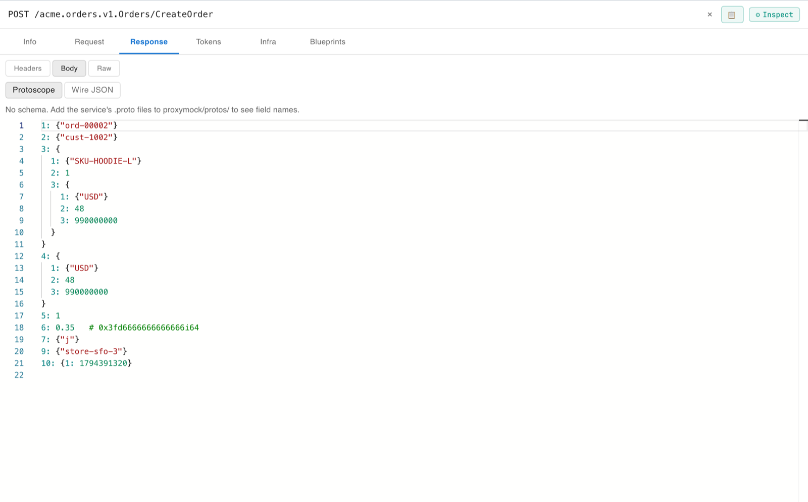
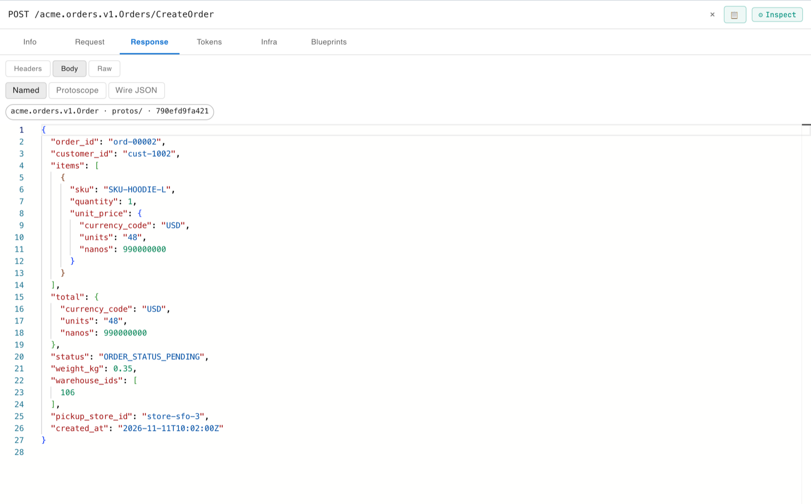
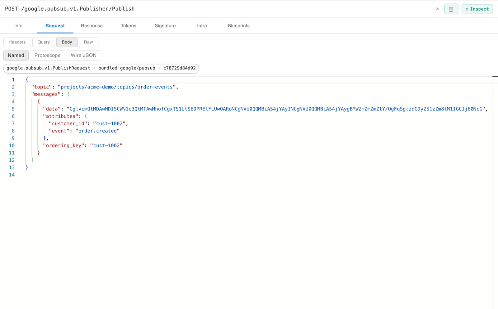
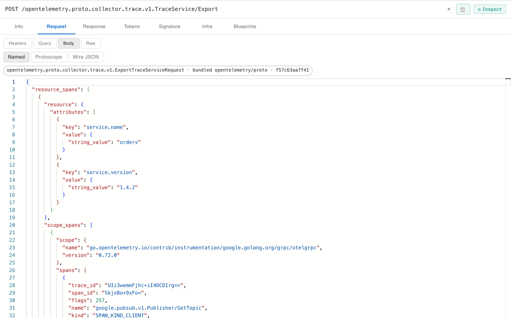
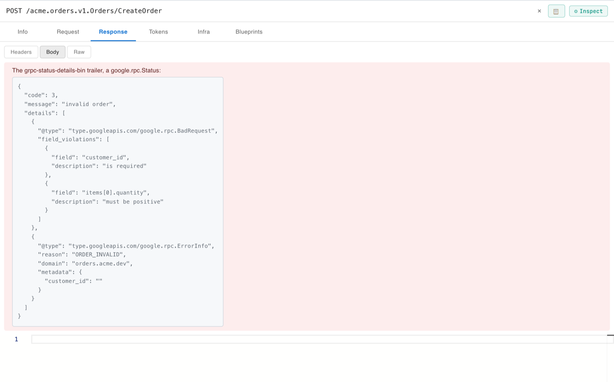

# gRPC and protobuf lab

Recorded gRPC traffic is binary protobuf. Without the service's schema, a recording can only show field numbers and wire types, and some values come out wrong. This lab records a small gRPC order service and reads the same calls three ways:

1. **Protoscope**, with no schema: every byte, by field number.
2. **Named fields** from the service's own `.proto` in `proxymock/protos/`.
3. **Public APIs with no schema at all**: Google Cloud Pub/Sub, gRPC health and OpenTelemetry calls named by the schemas built into proxymock, and gRPC error details decoded.

The checked-in recording runs with no network, so everything below also works in a Codespace.

## The service

```
client ──► orders (gRPC, :9090) ──► Google Cloud Pub/Sub   publishes an event for each order
                                └─► OpenTelemetry (OTLP)    exports a trace of every call
```

`orders` serves `acme.orders.v1.Orders`, defined in [`proxymock/protos/acme/orders/v1/orders.proto`](proxymock/protos/acme/orders/v1/orders.proto). Its messages use the shapes that are hardest to read as raw protobuf: nested messages, an enum, a `double`, a packed `repeated int32`, a `oneof`, a `google.protobuf.Timestamp`, `google.type.Money`, and a server-streaming RPC, `WatchOrder`. The `.proto` imports `google/api/annotations.proto` like most real services do.

The client sends a fixed sequence: a health check, four orders (one rejected with a `google.rpc.BadRequest`), five lookups (one for an order that does not exist) and a status stream.

Pub/Sub is the Go client library's own fake, `pstest`, which speaks the real `google.pubsub.v1` gRPC API with no Google account or project. The OTLP collector is a small receiver that counts spans.

## Prerequisites

- Go 1.26 or newer, and `nc`
- proxymock with the built-in schemas. `proxymock protos list` prints a `Built in:` line when yours has them; the `.proto` here needs them to compile, because it imports `google/api` and `google/type` without carrying those files.

Run every command below from this `labs/grpc` directory of your `mock-lab` clone.

## 1. Protoscope, with no schema

Every protobuf body has a **Protoscope** view, schema or not. To see what the recording looks like before anyone supplies a `.proto`, move the schema aside and open proxymock web:

```shell
mv proxymock/protos /tmp/orders-protos
make web
```

Open a `CreateOrder` call, then **Response** > **Body**:



The fields are numbers, `google.type.Money` is three anonymous fields, and two values are misleading. Field 6, the order weight, is a `double` shown only as a decoded guess. Field 7, the packed list of warehouse IDs `[106]`, shows as the string `"j"`, because byte 106 is a printable character. Nothing in the bytes says which reading is right.

Put the schema back before the next stage:

```shell
mv /tmp/orders-protos proxymock/protos
```

## 2. Named fields from the service's `.proto`

proxymock reads schemas from the workspace's `proxymock/protos/` directory, and resolves a gRPC call's message types from its method path, `/acme.orders.v1.Orders/CreateOrder`. With the `.proto` in place, the same response opens in a **Named** view:



The badge names the type, `acme.orders.v1.Order`, the schema it came from and its digest. The warehouse list is `[106]`, the enum reads `ORDER_STATUS_PENDING`, the `oneof` shows which branch was set (`pickup_store_id`), and the timestamp is a date. **Protoscope** is still there, now with the field names as comments, and **Wire JSON** is the stored form that blueprints edit.

The same view is available from the command line, which prints how every recorded body resolves:

```shell
make check
```

```text
proxymock/recording/localhost/2026-11-11_23-22-55.148491Z.md  /acme.orders.v1.Orders/CreateOrder
  request   acme.orders.v1.CreateOrderRequest  from protos/ (790efd9fa421, matched by grpc-method)
  response  acme.orders.v1.Order  from protos/ (790efd9fa421, matched by grpc-method)
```

`WatchOrder` is a server stream; its Named view is one object per message, in an array.

To add schemas to your own workspace, use `proxymock protos add <dir or file>`. It copies each `.proto` with the files it imports, and leaves out the ones proxymock has built in.

## 3. Public APIs and error details, with no upload

The orders service's outbound calls are named too, although this lab has no schema for them. proxymock has the schemas of googleapis, grpc-proto and opentelemetry-proto built in, so Pub/Sub, gRPC health and OTLP calls resolve by their method paths alone:





The badge says `bundled google/pubsub` or `bundled opentelemetry/proto`. A schema in `proxymock/protos/` that declares the same type always wins over a built-in one.

The rejected order has no response body. Its error is in the `grpc-status-details-bin` trailer, a `google.rpc.Status` whose details explain what was wrong, decoded above the body:



The `GetOrder` for `ord-99999` carries a `google.rpc.ResourceInfo` the same way.

## 4. Mock the dependencies and replay, offline

```shell
make replay
```

`scripts/replay.sh` starts `proxymock mock`, which answers the service's Pub/Sub and OTLP calls from the recording on the same ports it recorded through, starts the orders service against them, and runs `proxymock replay` with the recorded client calls. Neither the Pub/Sub fake nor the OTLP collector runs, and nothing leaves the machine.

Eight of the ten recorded calls replay with responses that match the recording, `WatchOrder`'s three stream messages included.

**Known issue:** the rejected `CreateOrder` and the `GetOrder` for a missing order are reported as failed, although the service returns exactly the recorded error status and the status-code mismatch column shows 0%. proxymock replay treats any gRPC error status as a failed request instead of a response to compare. Until that is fixed, a recording with expected gRPC errors does not replay green.

To run the pieces yourself, `make mock` runs the mocks in the foreground. Then start the service against them with `PORT=9090 PUBSUB_ADDR=localhost:18085 OTLP_ADDR=localhost:14317 ./bin/orders`.

## Record it again

```shell
make record
```

`scripts/record.sh` starts the Pub/Sub fake and the OTLP collector, then `proxymock record` with two reverse proxies:

```
client ──► :4143 proxymock ──► :9090 orders ──► :18085 proxymock ──► :8085 pubsub-fake
                                            └─► :14317 proxymock ──► :4317 otlp-collector
```

The service connects to `localhost:18085` and `localhost:14317` directly. gRPC clients skip `HTTPS_PROXY` for `localhost`, so `--map` reverse proxies are how proxymock sees calls between local processes. The recording lands in `proxymock/recording`: inbound calls under `localhost`, Pub/Sub under `localhost-8085` and OTLP under `localhost-4317`.

Order IDs and timestamps are derived from the order number, so a new recording holds the same bodies as the checked-in one.

## Change the `.proto`

```shell
GOOGLEAPIS=/path/to/googleapis make gen
```

`scripts/gen.sh` regenerates the Go code in `gen/` from `proxymock/protos/`, so the service and proxymock always read the same schema. It needs `protoc`, `protoc-gen-go`, `protoc-gen-go-grpc` and a googleapis checkout for the imports.

## Files

| Path | What it is |
| --- | --- |
| `cmd/orders` | The order service under test |
| `cmd/client` | The fixed sequence of client calls |
| `cmd/pubsub-fake` | Pub/Sub, served from memory by `pstest` |
| `cmd/otlp-collector` | An OTLP/gRPC trace receiver |
| `proxymock/protos` | The service's `.proto`, read by proxymock and by `scripts/gen.sh` |
| `proxymock/recording` | The checked-in recording |
| `gen` | Generated Go code |
| `scripts` | `record.sh`, `replay.sh` and `gen.sh` |
